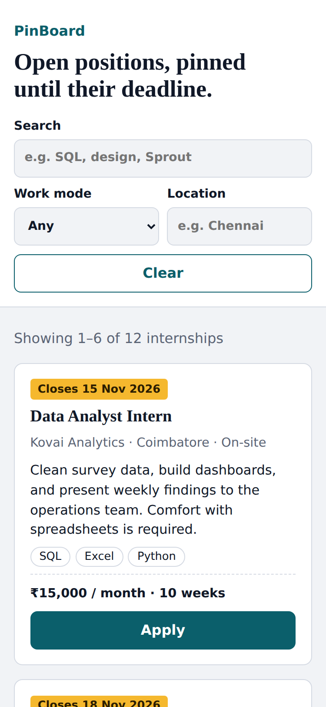
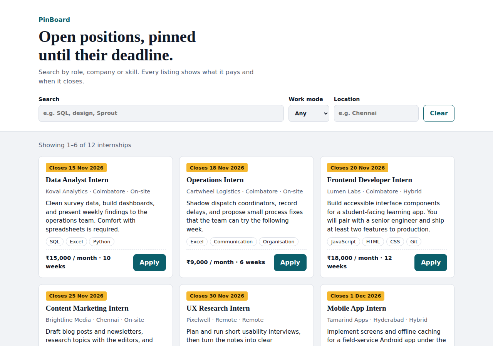

# PinBoard

A small internship job board: browse listings, filter them, and apply in under two minutes, on a phone or a laptop.
Vanilla JavaScript frontend, Node.js + SQLite backend, **zero dependencies** (nothing to `npm install`).

- **Live app:** `PASTE-YOUR-LIVE-URL-HERE`
- **Walkthrough video:** `PASTE-YOUR-VIDEO-URL-HERE`
- **Test evidence:** [`TEST_REPORT.md`](TEST_REPORT.md) · [`PERFORMANCE_REPORT.md`](PERFORMANCE_REPORT.md) · [`docs/QA.md`](docs/QA.md) · [`SECURITY_CHECKLIST.md`](SECURITY_CHECKLIST.md)

| Phone | Desktop |
|---|---|
|  |  |

## Run it locally

Needs **Node.js 22.13 or newer** (`node -v`). In a terminal:

```bash
cd pinboard
npm start
```

Open **http://localhost:3000**. Stop with `Ctrl+C`.

> **Windows PowerShell:** if `npm start` says "running scripts is disabled", use `npm.cmd start`, or run
> `Set-ExecutionPolicy -Scope CurrentUser -ExecutionPolicy RemoteSigned` once.

| Command | What it does |
|---|---|
| `npm start` | Run the app on http://localhost:3000 |
| `npm test` | Run all 133 automated tests |
| `npm run qa` | Run the tests and a load test, then write `TEST_REPORT.md` and `PERFORMANCE_REPORT.md` |
| `npm run demo:failures` | Run with failure simulation (see below) |

### See the loading, error and retry states
Start with `npm run demo:failures`, then open:

- `http://localhost:3000/?simulate=slow`: skeleton cards for about 2.5 s
- `http://localhost:3000/?simulate=error`: failure panel with a **Try again** button
- `http://localhost:3000/?simulate=flaky`: fails twice, then succeeds; the page retries by itself

The `simulate` switch is ignored unless the server was started with `--chaos`.

## Features

- Search by role, company or skill; filter by work mode and location; paginate
- Filters live in the URL, so a filtered view can be bookmarked or shared and survives a refresh
- "Closing soon" badge for listings that close within 14 days
- Apply form with inline validation on the client **and** the server, a character counter, and clear messages for duplicates, rate limits and outages
- The listing you applied to shows "Applied ✓" on this device
- Visible loading skeletons, error panel with retry, empty state, offline message, automatic retry for failed reads
- Phone-first layout: 44 px touch targets, 16 px inputs (no iOS zoom), apply form becomes a bottom sheet
- Light and dark mode, keyboard-friendly, skip link, reduced-motion support

## Configuration

All optional. Set as environment variables.

| Variable | Default | Meaning |
|---|---|---|
| `PORT` | `3000` | Port to listen on |
| `HOST` | `127.0.0.1` | Interface. Use `0.0.0.0` in containers and on hosting platforms |
| `DB_FILE` | `data/board.sqlite` | SQLite file (`:memory:` for a throwaway database) |
| `LOG_LEVEL` | `info` | `debug`, `info`, `warn`, `error` or `silent` |
| `TRUST_PROXY` | unset | Set to `1` when behind **one** reverse proxy (Render, Heroku, nginx) so rate limits see real client IPs |

macOS/Linux: `PORT=4000 npm start`. Windows PowerShell: `$env:PORT=4000; npm.cmd start`.

## API

| Method and path | Notes |
|---|---|
| `GET /api/internships?q=&type=&location=&page=&pageSize=` | `type`: `remote`, `hybrid`, `onsite`. Returns `{ data, meta: { page, pageSize, total, totalPages } }` |
| `GET /api/internships/:id` | One listing, or 404 |
| `POST /api/applications` | JSON: `internshipId, fullName, email, school?, coverNote, consent`. 201 on success |
| `GET /api/health` | Liveness: process is up. Never touches the database |
| `GET /api/ready` | Readiness: runs a real database query. 200 ready, 503 unavailable |

Errors always look like `{ "error": { "code", "message", "fields?" } }`. Statuses used: 400, 404, 405, 409 (duplicate),
413, 414, 415, 422 (validation), 429 (with `Retry-After`), 500 (generic), 503.

## Health checks and logging

- **Health:** point your platform's health check at `/api/ready`. Probes are exempt from rate limiting so they can never be blocked.
- **Logs:** one JSON object per line on stdout, e.g.
  `{"time":"…","level":"info","msg":"request","requestId":"…","method":"GET","path":"/api/internships","status":200,"ms":4.2}`
- Every response has an `X-Request-Id` header; the same id appears in the log line, so you can trace one user's failed request.
- Events: `startup`, `request`, `application_created`, `rate_limited`, `shutdown`. 4xx are `warn`, 5xx are `error` with a stack trace.
- **Privacy:** logs never contain names, emails, note text or query strings. Only ids, paths, statuses and timings.

## How it is built

```
src/server.js     starts the server, reads env vars, handles shutdown signals
src/app.js        routing, rate limits, request ids, gzip/ETag, static files, error handling
src/security.js   secure headers + rate limiter
src/validate.js   SERVER-side validation
src/db.js         SQLite schema, indexes, seed, parameterized queries
src/logger.js     structured JSON logger
public/           index.html, app.js (UI states + API client), validation.js (CLIENT-side), styles.css
data/             seed listings (deadlines are relative, so a fresh deploy never looks stale)
tests/            133 automated tests + optional real-browser script (tests/e2e)
scripts/          report and load-test generators
docs/             QA evidence, product notes, deployment, walkthrough script, screenshots
```

Key decisions: no framework and no build step (fast first paint, nothing to break); SQLite (zero setup, real SQL, parameterized);
the browser never trusts itself, the server re-validates everything; the UI builds the DOM with `textContent` so API data can never inject markup.

## Deploy

See [`docs/DEPLOYMENT.md`](docs/DEPLOYMENT.md). Short version: connect this repo to **Render** (a `render.yaml` blueprint is included),
or run the included `Dockerfile` anywhere.

## Quality evidence

| Area | Evidence |
|---|---|
| Regression | 133 automated tests, run on every push by GitHub Actions (`.github/workflows/ci.yml`) |
| Accessibility | Contrast ratios computed from the real CSS, structure checks, 30 real-browser checks incl. keyboard flow; manual steps in `docs/QA.md` |
| Performance | `PERFORMANCE_REPORT.md`; first load under 30 KB gzipped, zero third-party requests |
| Security | `SECURITY_CHECKLIST.md`; SQL injection, traversal, header, rate-limit and leak tests |
| Mobile | 375 px layout verified in headless Chromium; screenshots in `docs/screenshots/` |

## Known limitations

- Rate limiting is in memory, per process; use a shared store if you run several instances
- Free hosting tiers have temporary disks: the SQLite file resets on restart (the app re-seeds itself). Use a persistent disk or a hosted database for real data
- No logins, admin view or email notifications: applications are stored but nobody is notified
- The supplied brief and data files were not available while building, so the API contract is my own

See [`docs/PRODUCT_NOTES.md`](docs/PRODUCT_NOTES.md) for what I would build next.

## License
MIT
